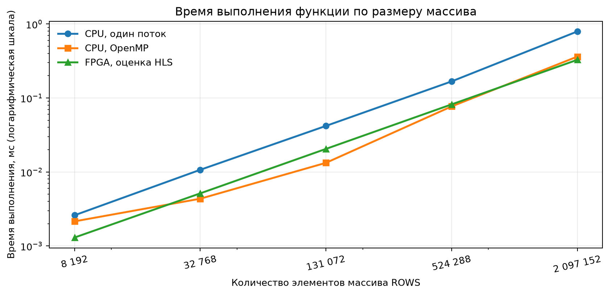
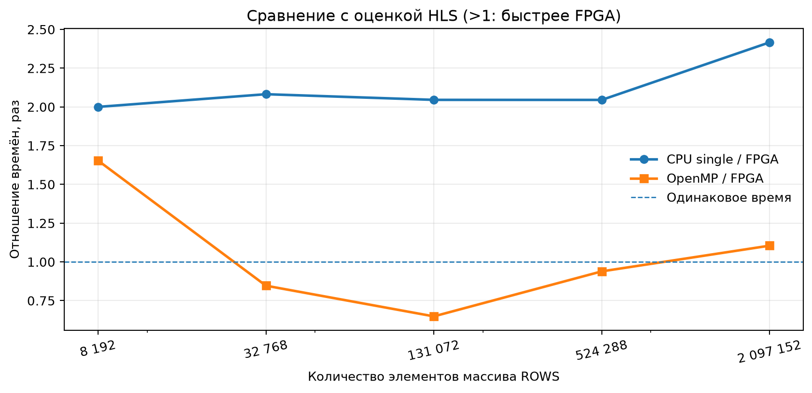
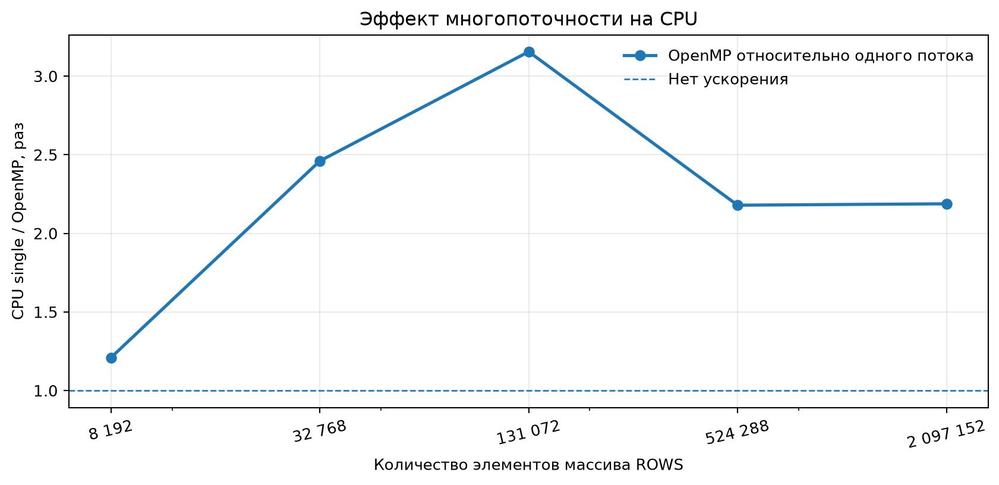

# Дополнение к отчёту по лабораторной работе lab4_z0

## Программная реализация и сравнительный анализ производительности

**Назначение раздела.** В аппаратной части исследована оптимизация поэлементного умножения с помощью UNROLL, ARRAY_RESHAPE и PIPELINE. Для сравнения с аппаратным компонентом исследованы однопоточная и многопоточная реализации на CPU. Этот материал предназначен для добавления **после аппаратной части** существующего отчёта; существующие скриншоты он не заменяет.

### 1. Алгоритм и способы выполнения

Исходный алгоритм вычисляет элемент результата по формуле:

$$out\_RES[i] = in\_A[i] \cdot in\_B[i], \quad i = 0, \dots, ROWS-1.$$

Результат каждой итерации независим от других итераций, поэтому один и тот же цикл допускает последовательное и многопоточное выполнение. Однопоточная реализация:

~~~cpp
for (std::ptrdiff_t i = 0; i < static_cast<std::ptrdiff_t>(rows); ++i) {
    out_RES[i] = in_A[i] * in_B[i];
}
~~~

Реализация OpenMP:

~~~cpp
#pragma omp parallel for schedule(static)
for (std::ptrdiff_t i = 0; i < static_cast<std::ptrdiff_t>(rows); ++i) {
    out_RES[i] = in_A[i] * in_B[i];
}
~~~

Директива parallel for распределяет независимые итерации между потоками CPU. При статическом распределении каждый поток получает свой диапазон индексов; это уместно, поскольку трудоёмкость итераций примерно одинакова. Обе версии компилируются с оптимизацией -O2; многопоточная дополнительно — с флагом -fopenmp.

В репозитории подготовлены два исполняемых файла Windows x64: **lab4_z0_single.exe** (один поток) и **lab4_z0_openmp.exe** (OpenMP). Исходные файлы расположены в каталоге Vitis_HLS/lab4_z0/src.

### 2. Проверка корректности и методика измерений

В обоих вариантах входные массивы заполняются детерминированными целочисленными данными. Перед измерениями выход функции сравнивается с эталонным массивом, вычисленным отдельно; проверка повторяется после каждого запуска и не включена во время функции.

Для одного размера массива функция вызывается **33 раза (CALLS=33)**. Время измеряется с помощью std::chrono::steady_clock: между запуском и остановкой таймера помещён **только вызов функции**, а выделение памяти, сравнение результатов, сортировка и печать выполняются вне измеряемого участка. После сортировки массива из 33 измерений итоговым значением выбирается медиана (17-й элемент в порядке возрастания, индекс 16). Медиана менее чувствительна к случайным задержкам планировщика и фоновых процессов.

Исследованы ROWS = **8192, 32768, 131072, 524288, 2097152**. Для воспроизводимого запуска используется run_all.bat. Отдельные EXE показывают результат до нажатия клавиши; режим --no-pause подходит для пакетного запуска.

**Характеристики стенда:** AMD Ryzen 5 5600, 6 физических ядер / 12 логических потоков; оперативная память 30 GiB (показание free -h); номинальная базовая частота модели 3,5 ГГц, максимальная частота по lscpu около 4,47 ГГц. Фактическая рабочая частота зависит от нагрузки и режима процессора.

### 3. Результаты

В таблице приведены **ранее сохранённые пользовательские измерения от 9 ноября 2026 года**. CPU измерялся выполнением программы с 33 запусками; аппаратные времена получены из оценок синтеза Vitis HLS для UNROLL factor=64, ARRAY_RESHAPE factor=64 и PIPELINE II=1.

**Таблица П1 — Продолжительность работы функции**

| ROWS | CPU, 1 поток, мс | CPU, OpenMP, мс | FPGA, оценка HLS, мс |
|---:|---:|---:|---:|
| 8 192 | 0,002600 | 0,002150 | 0,001300 |
| 32 768 | 0,010701 | 0,004350 | 0,005140 |
| 131 072 | 0,041931 | 0,013290 | 0,020500 |
| 524 288 | 0,167574 | 0,076912 | 0,081940 |
| 2 097 152 | 0,792609 | 0,362309 | ≈ 0,328000 |

{width=14cm}

Время выполнения всех трёх вариантов растёт с увеличением размера массива. На графике применена логарифмическая шкала по оси времени, чтобы были различимы малые значения и результаты для больших массивов.

### 4. Сравнительный анализ

Для анализа используется отношение времён: CPU single / FPGA и OpenMP / FPGA. Значение больше единицы означает, что время CPU больше аппаратной оценки. Ускорение многопоточной версии относительно однопоточной определяется как CPU single / OpenMP.

**Таблица П2 — Относительные показатели**

| ROWS | Ускорение OpenMP, раз | CPU single / FPGA, раз | OpenMP / FPGA, раз |
|---:|---:|---:|---:|
| 8 192 | 1,21 | 2,00 | 1,65 |
| 32 768 | 2,46 | 2,08 | 0,85 |
| 131 072 | 3,16 | 2,05 | 0,65 |
| 524 288 | 2,18 | 2,05 | 0,94 |
| 2 097 152 | 2,19 | 2,42 | 1,10 |

{width=14cm}

Во всех пяти случаях оценка времени аппаратной функции ниже измеренного времени однопоточной программы (примерно в 2,0–2,4 раза). Однако OpenMP быстрее оценочного FPGA при ROWS = 32768, 131072 и 524288, тогда как оценка FPGA меньше при 8192 и 2097152. Таким образом, утверждение о безусловном преимуществе FPGA над OpenMP для всех ROWS не подтверждается.

{width=14cm}

OpenMP ускорил выполнение CPU-алгоритма во всех пяти сохранённых сериях измерений. Наибольшее ускорение, примерно **3,16 раза**, получено при ROWS=131072. Ускорение не пропорционально 12 логическим потокам из-за накладных расходов на параллелизм и ограничений подсистемы памяти.

### 5. Вывод

В программной части подготовлены два варианта реализации поэлементного умножения массивов: однопоточный и OpenMP. Проверена корректность выходных данных, использованы 33 измерения и медиана. По сохранённым значениям OpenMP обеспечивает ускорение относительно одного потока в пределах 1,21–3,16 раза. Оптимизированная аппаратная реализация имеет более низкую оценку времени, чем один поток CPU, но не во всех случаях опережает OpenMP.

Сравнение имеет методическое ограничение: время CPU является измеренным временем выполнения функции, а время FPGA — оценкой HLS без обмена данными с внешним хостом. Поэтому по графикам нельзя делать вывод о реальной задержке всей системы с передачей данных на FPGA и обратно.

**Воспроизводимость.** Данные таблиц относятся к ранее выполненному эксперименту **9 ноября 2026 года**, а не к запуску новых бинарников GitHub Actions. Исполняемые файлы пересобраны **24 ноября 2026 года**. Для окончательной версии отчёта рекомендуется выполнить run_all.bat на собственном ПК и при необходимости заменить сохранённые показатели. Для демонстрации преподавателю можно добавить реальный скриншот консоли с Correctness: PASS, CALLS: 33 и Median function time; такой скриншот не создавался искусственно.

**Основание методики:** задание lab4_z0, с. 7–10; лекция 3 по HLS-синтезу, с. 35–38; лекция 4, с. 38–41.
